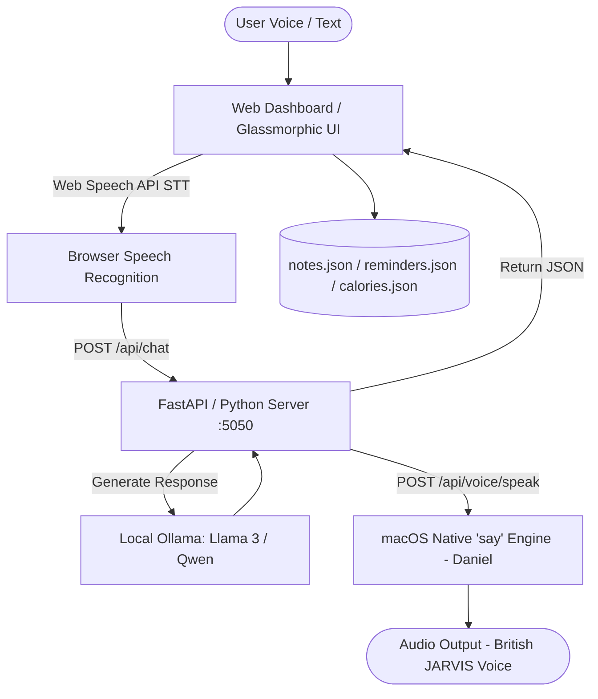

# ⚡ JARVIS — Autonomous AI Assistant & Cyber-Command OS

<p align="center">
  
  
  
  
  
  
</p>

---

> *"At your service, sir. All systems are online and operational."*

**JARVIS** is a personalized, offline-first personal AI assistant and productivity operating system created by **[Maitrayee Dighe](https://github.com/MaitrixXD)**. Inspired by Tony Stark's iconic J.A.R.V.I.S., this system merges real-time hands-free voice interaction, local LLM intelligence, deep-work study modes, multimedia control, and personal life tracking into a single unified cyber-glass interface.

---

## 🌟 Key Highlights

- **🔒 100% Private & Local AI**: Powered by local **Ollama** models (`llama3`, `qwen3.5`, etc.) with zero external API fees and total data privacy.
- **🎙️ Full-Duplex Voice Agent**: Continuous voice loop combining Web Speech API for low-latency Speech-to-Text (STT) and native **macOS Daniel TTS** (British English) for that authentic JARVIS persona.
- **🏔️ Immersive Mountain Backdrops**: Sleek, distraction-free glassmorphic UI across all dashboard views with high-definition atmospheric mountain visuals.
- **🎯 "Lock In" Study & Focus Cockpit**: Custom focus timers, ambient lo-fi music feeds, and live task checklist designed for high-intensity study and programming sessions.
- **🎵 Entertainment & YouTube Music**: Seamless video playback, custom music search bar to stream any track via YouTube Music, curated relaxing playlists, and live news feeds.
- **⚡ Quick Notes & Local Persistence**: Real-time synchronization between dashboard quick notes and local JSON/file storage.
- **🥗 Health, Reminders & Messaging**: Integrated calorie counter, smart prioritized task reminders with audio cues, and WhatsApp message simulation with call logs.

---

## 🖥️ Modules & Features

| Module | Icon | Description |
|---|:---:|---|
| **Home Command** | 🏠 | Central AI overview, real-time clock, assistant status, quick notes capture, and daily agenda. |
| **Voice Agent** | 🎙️ | Hands-free conversational interface. Talk naturally; JARVIS replies audibly in real time with the Daniel voice. |
| **Lock In Mode** | 🎯 | Study cockpit with countdown timer, Pomodoro cycles, focused audio streams, and task tracking. |
| **Entertainment** | 🎬 | YouTube video embed player, custom YouTube Music search bar, and curated relaxation feeds. |
| **Smart Reminders** | ⏰ | Prioritized task manager (High, Medium, Low), due date tagging, and audio alerts. |
| **Notes & Files** | 📝 | Quick capture workspace with category tags (`Study`, `Quick Note`), auto-saving to local storage. |
| **Calorie Tracker** | 🥗 | Daily nutrition logger, macronutrient progress bars, meal logging, and target monitors. |
| **Messages & Logs** | 💬 | WhatsApp conversations preview and call history logging interface. |
| **System Insights** | 📊 | Local assistant metrics, status pings, and hardware utilization statistics. |
| **Settings** | ⚙️ | Model selector (`llama3:latest`, `qwen`), speech rate, volume, and voice preferences. |

---

## 🛠️ Architecture & Tech Stack



- **Backend**: Python 3.10+, FastAPI, Uvicorn, `subprocess` audio bridge
- **Intelligence**: Ollama running locally at `http://localhost:11434`
- **Voice Synthesis**: Native macOS speech synthesizer (`say -v Daniel -r 185`)
- **Speech Recognition**: HTML5 Web Speech Recognition API
- **Frontend**: Vanilla HTML5, CSS3 Glassmorphism, Vanilla ES6+ JavaScript
- **Core Framework Submodule**: [OpenJarvis](https://github.com/open-jarvis/OpenJarvis)

---

## 🚀 Quick Start Guide

### 1. Prerequisites
- **macOS** (for native `say -v Daniel` TTS; Daniel voice can be downloaded in *System Settings → Accessibility → Spoken Content → Voices*)
- **Python 3.10+**
- **Ollama** installed and running:
  ```bash
  # Install Ollama (if not already installed)
  brew install ollama

  # Pull your preferred model
  ollama pull llama3:latest
  # or
  ollama pull qwen2.5-coder:latest
  ```

### 2. Clone the Repository

#### Option A: Clone this personalized repo with the original OpenJarvis submodule (Recommended)
```bash
git clone --recursive https://github.com/MaitrixXD/Jarvis.git
cd Jarvis
```

> **Note:** If you already cloned without `--recursive`, initialize and fetch the original OpenJarvis submodule:
> ```bash
> git submodule update --init --recursive
> ```

#### Option B: Clone the original OpenJarvis upstream repository directly
To explore or contribute to the foundational OpenJarvis project directly, you can clone from the official upstream repository:
```bash
git clone https://github.com/open-jarvis/OpenJarvis.git
```

---

### 3. Install Dependencies
```bash
pip install fastapi uvicorn requests
```

### 4. Launch JARVIS
Start the dashboard server:
```bash
python3 dashboard/server.py
```

Open your browser and navigate to:
```
http://localhost:5050
```

---

## 🎙️ Interacting with Voice Mode

1. Click **"Start Voice Agent"** in the left sidebar or the top-right header.
2. Grant microphone access when prompted by the browser.
3. Speak your request aloud. Example prompts:
   - *"Jarvis, what's my agenda for today?"*
   - *"Tell me a joke about computer science."*
   - *"Help me revise operating system concepts."*
   - *"Play some focus music."*
4. JARVIS will process your speech through Ollama and reply through your speakers using the Daniel voice.

---

## 📁 Repository Structure

```plaintext
Jarvis/
├── dashboard/
│   ├── index.html               # Single-page Glassmorphic dashboard UI
│   ├── server.py                # FastAPI backend & macOS audio bridge
│   ├── backdrop.jpg             # Atmospheric mountainous dashboard backdrop
│   ├── notes.json               # Synced user notes storage
│   ├── reminders.json           # Scheduled reminders & tasks
│   ├── calories.json            # Calorie and dietary intake log
│   ├── whatsapp_messages.json   # Message simulation cache
│   └── call_logs.json           # Communication history
├── OpenJarvis/                  # Submodule: OpenJarvis framework
├── notes/                       # Project documentation & reference notes
├── hello_jarvis.py              # Command-line voice assistant runner
├── .gitignore                   # Ignored files, virtual environments, logs
├── .gitmodules                  # Submodule configuration
└── README.md                    # Project documentation
```

---

## 💡 Customization & Tips

- **Change Voice**: If you prefer another macOS voice, modify the voice parameter in `dashboard/server.py`:
  ```python
  subprocess.Popen(["say", "-v", "Daniel", "-r", "185", text])
  ```
  Check available voices on your Mac with `say -v ?`.
- **Change Default LLM Model**: In `dashboard/server.py` or the in-app Settings page, you can switch between `llama3:latest`, `qwen3.5:4b`, `qwen2.5-coder:latest`, or any model running on your local Ollama instance.

---

## 👩‍💻 Author

Created with 💙 by **Maitrayee Dighe**  
- **GitHub**: [@MaitrixXD](https://github.com/MaitrixXD)
- **Project**: [Jarvis](https://github.com/MaitrixXD/Jarvis)

---

## 📜 License & Acknowledgments

- **Original Repository & Upstream Framework**: This project is built upon, customized, and extended from the original open-source [OpenJarvis repository](https://github.com/open-jarvis/OpenJarvis) (`https://github.com/open-jarvis/OpenJarvis`). Huge credit and appreciation to the OpenJarvis contributors and maintainers for the foundational architecture.
- **Local AI Engine**: Powered by [Ollama](https://ollama.com/) running open weights (Llama 3, Qwen).
- **Speech Synthesis**: Native macOS British speech synthesizer (`Daniel`).
- **License**: Released under the [MIT License](LICENSE) — feel free to fork, customize, and build your own dream AI assistant!
